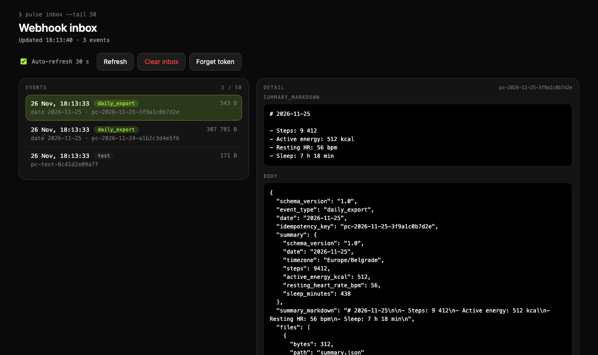

# Pulse Commit webhook receiver

A Cloudflare Worker that accepts the [Pulse Commit](https://pulsecommit.app) webhook. One codebase, two Wrangler environments:

| Environment | Worker name | Stores requests | Viewer |
| --- | --- | --- | --- |
| `review` (default) | `pulsecommit-review-hook` | No | No (`GET /` and `/events` return 404) |
| `inbox` | `pulsecommit-inbox` | Latest 50 in Workers KV, 7 day TTL | `GET /` |

`review` checks the token and the body, answers `200` and discards the body. It stores and logs nothing and has no bindings. It is the endpoint used for App Review.

`inbox` runs the same checks, then keeps each accepted request so you can watch real deliveries while testing.

## Privacy

- `review` never stores, logs or echoes a body or header.
- `inbox` stores the full request body in a KV namespace in **your** Cloudflare account for up to 7 days. A `daily_export` body contains your Health summary (`summary`, `summary_markdown`, file manifest). Anyone with the view token can read it. Run `DELETE /events` or the Clear inbox button when you are done, or delete the Worker and the namespace.
- The `Authorization` header and both tokens are never stored. Stored fields: `received_at`, `event_type`, `date`, `idempotency_key`, `user_agent`, `bytes`, `body`.
- Both environments disable observability and Logpush in `wrangler.jsonc`.

Pulse Commit does not run this server. If you deploy it, you operate it.

## Request checks (both environments)

- `POST /` only for deliveries.
- `Authorization: Bearer <token>` is compared in constant time with the `WEBHOOK_TOKEN` secret. Missing or wrong token returns 401. If the secret is not set, every request returns 401. Keep the header name in the app as `Authorization`.
- `Content-Type` must be `application/json` (415 otherwise). Body limit is 1 MB (413 above).
- The JSON body must be an object with `event_type` of `daily_export` or `test`. A `daily_export` also needs a `summary` object and a `date` string. Otherwise 400.
- Success returns `200 {"ok":true,"event_type":"...","bytes":N}`.

## Inbox endpoints

| Request | Auth | Result |
| --- | --- | --- |
| `GET /` | none | Viewer page. Contains no data; it asks for the view token and keeps it in `sessionStorage` for that tab only. |
| `GET /events` | `Bearer <VIEW_TOKEN>` | `{"ok":true,"events":[...]}`, latest 50, newest first. A `body` over 256 KB is cut to its first 256 KB of JSON text and the event gets `"truncated": true`. |
| `GET /events/<id>` | `Bearer <VIEW_TOKEN>` | `{"ok":true,"event":{...}}` with the full body. `<id>` is the event's `id`, URL-encoded. 404 if unknown. |
| `DELETE /events` | `Bearer <VIEW_TOKEN>` | `{"ok":true,"deleted":N}` |

`VIEW_TOKEN` is a separate secret from `WEBHOOK_TOKEN`. The webhook token cannot read events and the view token cannot post them. The two tokens must differ: if `VIEW_TOKEN` equals `WEBHOOK_TOKEN`, every route returns `500 {"ok":false,"error":"misconfigured"}`.

The `Bearer` scheme is matched case-insensitively.

Events are stored under `evt:<ISO time>:<id>`, where `<id>` is the `Idempotency-Key` header, else the body's `idempotency_key`, else a random UUID. After each write, keys beyond the latest 50 are deleted. If that cleanup fails, the delivery still returns 200 and the next write retries it.



The viewer refreshes every 30 s while the tab is visible. After 10 minutes without a click, key press or scroll it pauses and shows "Paused - click Refresh to resume". Untick Auto-refresh to stop. Opening an event fetches the full event with `GET /events/<id>`.

### KV free plan limits

Free plan: 100,000 reads, 1,000 writes, 1,000 deletes and 1,000 lists per day, reset 00:00 UTC. Each refresh = 1 list + up to 50 reads, and opening an event = 1 read. Each delivery = 1 write + 1 list, plus 1 delete once 50 are stored. Clearing the inbox = 1 list + 1 delete per stored event.

At 30 s, a visible viewer uses 120 lists and up to 6,000 reads per hour, so the idle pause keeps a forgotten tab from using up the daily list budget. See [Workers KV limits](https://developers.cloudflare.com/kv/platform/limits/).

## Deploy

Generate tokens with `openssl rand -base64 32 | tr '+/' '-_' | tr -d '='`, or use the Generate button in the app for `WEBHOOK_TOKEN`.

### review

```sh
npm ci
npx wrangler secret put WEBHOOK_TOKEN --env review
npx wrangler deploy --env review
```

### inbox

```sh
npm ci
npx wrangler kv namespace create EVENTS
```

Put the printed `id` in `wrangler.jsonc` in place of `REPLACE_WITH_KV_ID`, then:

```sh
npx wrangler secret put WEBHOOK_TOKEN --env inbox
npx wrangler secret put VIEW_TOKEN --env inbox
npx wrangler deploy --env inbox
```

Open `https://pulsecommit-inbox.<your-subdomain>.workers.dev/` and paste the view token.

## Point Pulse Commit at it

1. In Pulse Commit open Destinations, Webhook.
2. Endpoint URL: the `https://pulsecommit-review-hook.<your-subdomain>.workers.dev/` or `https://pulsecommit-inbox.<your-subdomain>.workers.dev/` address printed by `wrangler deploy`.
3. Header: `Authorization`. Token: the value you stored in `WEBHOOK_TOKEN`.
4. Tap Send test. The receiver answers `200` with `"event_type":"test"`. In `inbox` the test appears in the viewer within 30 s, or at once after Refresh.

## curl

```sh
curl -i -X POST https://pulsecommit-inbox.<your-subdomain>.workers.dev/ \
  -H "Authorization: Bearer $WEBHOOK_TOKEN" \
  -H 'Content-Type: application/json' \
  -H 'Idempotency-Key: pc-2026-11-25-3f9a1c0b7d2e' \
  -d '{"schema_version":"1.0","event_type":"daily_export","date":"2026-11-25","summary":{"steps":9412},"summary_markdown":"# 2026-11-25\n\n- Steps: 9 412\n"}'

curl -s https://pulsecommit-inbox.<your-subdomain>.workers.dev/events \
  -H "Authorization: Bearer $VIEW_TOKEN"
```

## Run locally

```sh
printf 'WEBHOOK_TOKEN=local-webhook-token\nVIEW_TOKEN=local-view-token\n' > .dev.vars
npx wrangler dev --env inbox --port 8799
```

Local KV lives in `.wrangler/` (ignored by Git). Open `http://127.0.0.1:8799/` and use `local-view-token`.

## Tests

```sh
npm test
npx wrangler deploy --dry-run --env review
npx wrangler deploy --dry-run --env inbox
```

## Optional variants

These are snippets, not part of the deployed Worker. Add them after the validation in `src/index.js`, where `payload` is the parsed body.

### Store each day in R2

Add to an environment in `wrangler.jsonc`:

```jsonc
"r2_buckets": [{ "binding": "EXPORTS", "bucket_name": "pulsecommit-exports" }]
```

Then, before the final `return json(200, ...)`:

```js
if (payload.event_type === "daily_export") {
  await env.EXPORTS.put(`${payload.date}.json`, JSON.stringify(payload), {
    httpMetadata: { contentType: "application/json" },
  });
}
```

Keying by `date` keeps one object per day, so a re-run overwrites the earlier one. This variant keeps your Health data in your own bucket.

### Forward the summary text to another URL

Add `FORWARD_URL` as a secret, then:

```js
if (payload.event_type === "daily_export" && typeof payload.summary_markdown === "string") {
  const upstream = await fetch(env.FORWARD_URL, {
    method: "POST",
    headers: { "Content-Type": "application/json" },
    body: JSON.stringify({ text: payload.summary_markdown }),
  });
  if (!upstream.ok) return json(502, { ok: false, error: "forward_failed" });
}
```

Whoever runs the forward target can read what it receives.

## License

MIT
